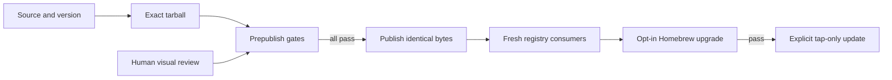
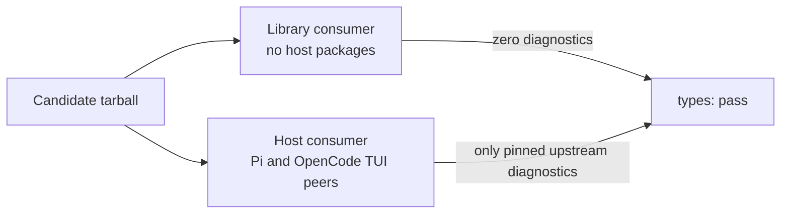
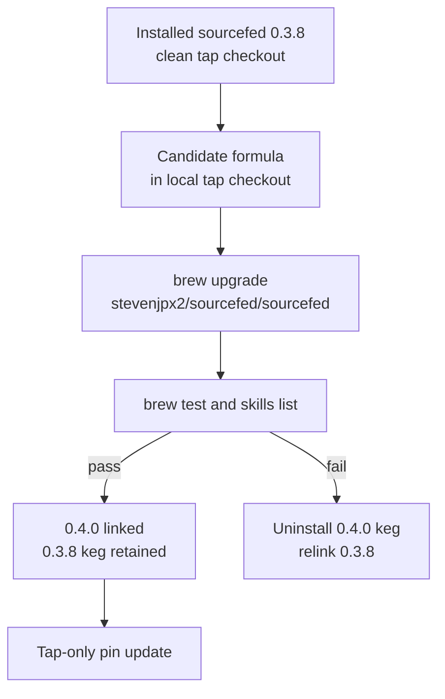

# End-to-End Release Plan

Status: In progress. Automated gates run against one exact tarball. Human visual
review is required before publication. Registry and explicitly authorized Homebrew
checks run after publication; Homebrew must pass before the public tap changes.

A maintainer verifies the package that users install, with isolated host state and
no live provider credentials. A dry run builds evidence without a commit, tag,
push, publication, deployment pin update or real Homebrew installation:

```sh
npm run release:verify -- --dry-run
```



## Version and artifact ownership

The root `package.json` supplies the version. The aggregate manifest and README
pins match it. Version `0.4.0` is staged in the review working tree; verification
does not create release commits or tags. The authorized versioning command is
`npm run release` (`changelogen --release --push`); use it only when a version and
tag operation are explicitly approved, not during a dry run.

`scripts/release/verify.mjs` packs `packages/sourcefed` once and retains the tarball
under `.release/candidate-*/`. Every candidate gate uses those bytes. A supplied
`--artifact <path>` verifies an existing tarball without repacking it.

`.release/manifest.json` records the version, SHA-256, SHA-512 npm integrity, source
commit and fingerprint, dirty state, Node and host versions, and each gate result.
Gate logs and Terminal Control captures live under `.release/`. Owned temporary
consumers, process groups, host sessions and directories are cleaned up.

## Required gates

Every gate reports `pass`, `fail` or `blocked`. There is no skip status. A missing
host, evidence input, timeout or dependency is a failure or blocker. Dirty-tree
dry runs produce evidence but cannot authorize publication.

- **Build:** `npm run check`, including release-tooling regression tests.
- **Package:** inspect the archive; validate every export, bin, Pi target, skill
  data, guidance, licence and declaration target; reject private runtime imports
  and private workspace packages; verify the ordinary install contains no Pi
  packages. `scripts/e2e/package.mjs` owns these checks.
- **Types:** two clean NodeNext consumers emit with `strict: true` and
  `skipLibCheck: false`; see [Type gate](#type-gate). `scripts/e2e/types.mjs` owns
  this gate.
- **CLI and daemon:** invoke npm’s installed bin; create, list, inspect, stop,
  start and remove an isolated fixture monitor; read skills and logs; restart the
  daemon from its owned state directory. `scripts/e2e/cli-daemon.mjs` reuses the
  installed-bin integration scenario.
- **MCP HTTP:** initialize, list/call tools, subscribe/read events, acknowledge
  delivery and reject missing authentication. **MCP stdio:** initialize, list
  tools, create a fixture monitor, read its resource, acknowledge an absent event
  idempotently and close. `scripts/e2e/mcp.mjs` owns both gates.
- **Provider polling:** Jira, GitHub and Slack use deterministic local HTTP
  fixtures; Yab uses a local stdio MCP fixture. Verify new events and cursor
  updates. **Webhooks:** signed GitHub and Slack requests cross a local HTTP
  server and verify signature rejection, delivery, replay deduplication, cursor
  persistence and acknowledgement. Jira exposes polling, not a webhook API.
  `scripts/e2e/providers.mjs` and `scripts/e2e/webhooks.mjs` own these gates.
- **OpenCode server:** load the installed plugin in a real private host, invoke
  its registered tool through a provider-free test command and verify isolated
  daemon state. Reuse `scripts/check-opencode-subscriptions.mjs` for 300 HTTP and
  trusted HTTPS subscriptions, unrelated fetch, delivery/ack, cancellation and
  socket cleanup. `scripts/e2e/opencode.mjs` coordinates these checks.
- **OpenCode TUI:** `scripts/e2e/terminal.mjs` drives the actual host with Terminal
  Control, an installed candidate, a private server and fixture monitor. It waits
  for visible autocomplete/dialog transitions, captures sidebar, monitor and log
  dialogs as PNG/TXT, records a timeline, then stops and prunes its own sessions.
  The configured `termctrl` path and version are part of the evidence.
- **Visual review:** a human reviews the exact candidate’s live-render captures
  for padding, clipping and duplicate identifiers. Missing review evidence blocks
  release even when automated text assertions pass.
- **Pi:** reuse `scripts/check-optional-pi.mjs` against the existing candidate
  consumer. Pi’s managed npm installer receives the exact tarball through its
  documented test-only `npmCommand` wrapper, then RPC confirms extension commands.
  The ordinary consumer and Pi-managed extension tree contain no Pi host copies.
  The tested Pi host supplies its optional peers. No model request is sent.

The provider-free OpenCode command exercises the registered tool directly. Model
stub integration is not a requirement: these gates test Sourcefed’s host boundary,
not a model’s decision to select a tool. Pi’s release boundary is its documented
RPC/package loader; interactive Pi rendering is outside this gate.

## Type gate



The library consumer imports every entry point except `./pi`, `./tui` and
`./opencode/tui`. It installs no host packages and must compile with zero
diagnostics. Public declarations depend on valibot 1.4.2 and @types/json-schema
7.0.15, so both are production dependencies.

The host consumer installs the peers that Pi and OpenCode supply at runtime: Pi
0.83.0, TypeBox 1.3.10, OpenCode plugin/theme 2.2.7, OpenTUI 0.8.1 and Solid
1.9.19. Its source assigns each host entry to the host's own type and holds three
`@ts-expect-error` checks; an `any` declaration makes those directives unused
and fails compilation:

```ts
export const extension: (pi: ExtensionAPI) => Promise<void> = sourcefedExtension

export const definitions: Plugin.Definition[] = [tui, openTui]

// @ts-expect-error OpenCode supplies the plugin context
void tui.setup()
```

Host entry points depend on third-party declarations that fail strict library
checking. The gate keeps `skipLibCheck: false`, so TypeScript still checks every
Sourcefed `.d.ts` file and the consumer. It accepts only these diagnostic sources:

| Source | Code | File |
| --- | --- | --- |
| pi-ai JSON model imports | TS1543 | `@earendil-works/pi-ai/dist/providers/*.models.d.ts` |
| Anthropic SDK undici-types paths | TS2307 | `@anthropic-ai/sdk/internal/types.d.mts` |
| Google GenAI optional MCP SDK | TS2307 | `@google/genai/dist/node/node.d.ts` |
| OpenTUI `KeyHandler.emit` with @types/node 26 | TS2416 | `@opentui/core/lib/KeyHandler.d.ts` |

Each rule names its code, file and, where needed, message. Any other diagnostic,
including one in Sourcefed's declarations or the consumer, fails the gate. The
manifest records how many diagnostics each rule accepted. Logs are
`.release/types-library.log` and `.release/types-host.log`.

## Isolation

Every gate uses an explicit environment allowlist: PATH, fixed terminal/CI values,
owned HOME, all XDG directories, npm cache, Pi settings and explicit OPENCODE_DB.
Only fixture settings are added. Inherited provider tokens, credentials, config
content and service discovery variables are absent.

The developer integration harness uses the same policy. Scenario-local fake
credentials are explicit; child environments do not merge the caller’s variables.
Process groups have deadlines and bounded output. Cleanup terminates only owned
processes. Terminal Control uses a short private socket directory and fresh state;
pruning applies only to that profile.

## Operator evidence

Supply visual evidence with `--tui-proof <file>`. Each JSON record binds to the
exact version, commit, SHA-256 and npm integrity. It names the
operator and host version, records a timestamp within 24 hours, and explicitly
attests human review, isolation and cleanup. Attached command logs and rendered
captures each have a checked SHA-256.

The fields are the evidence contract, not a generated approval:

```json
{
  "gate": "opencode-tui",
  "version": "0.4.0",
  "commit": "…",
  "sha256": "…",
  "integrity": "sha512-…",
  "operator": "…",
  "hostVersion": "…",
  "at": "…",
  "humanReviewed": true,
  "isolated": true,
  "cleanedUp": true,
  "checks": { "real-termctrl": true },
  "files": [{ "path": "monitors.png", "sha256": "…" }]
}
```

The visual checks are `real-termctrl`, `sidebar`, `monitor-dialog`, `logs-dialog`,
`padding`, `no-clipping` and `no-duplicate-ids`. Every named check is required.
Mechanical validation checks binding and completeness; the named operator
supplies the truth of the human review.

## Post-publication Homebrew check

Homebrew reports `pending: post-publish` in dry runs. Its formula consumes the
published npm artifact, and Apple Silicon’s supported custom prefix is at most
13 bytes. The release check therefore uses the real prefix only after explicit
operator opt-in, after registry verification, and before the public tap update:

```sh
npm run release:homebrew -- --confirm-real-homebrew
npm run release:pins -- --tap
```



Homebrew loads formulae only from taps; installing from a file path is disabled.
`scripts/release/homebrew.mjs` therefore writes the candidate formula, with the
verified version and tarball SHA-256, over the installed tap's local checkout. It
restores the original bytes after the upgrade, test or failure; the public tap is
unchanged. The candidate is retained as `.release/homebrew-formula.rb`.

The check requires one installed Sourcefed keg from `stevenjpx2/sourcefed`, linked
`opt` and `bin` paths and a clean tap checkout. Outdated Sourcefed dependencies
block it, and the upgrade dry run must name no dependency. Auto-update, cleanup,
autoremove and dependent upgrades are disabled, so the previous keg remains.

On success, the candidate stays installed and linked. The previous keg remains
for rollback until `brew cleanup sourcefed`. On failure, `brew uninstall`
removes only the opt-linked candidate keg, and `brew link` relinks the single
remaining keg. Inventory, `opt` and `bin` links and tap status must then equal
the initial snapshot. On either result, every formula other than Sourcefed must be
unchanged.

The manifest records published npm integrity, tarball and formula hashes, the
previous and installed versions, the Homebrew version and `.release/homebrew.log`.
The formula's own test, `sourcefed monitor sources`, uses the operator's default
daemon URL. The real Homebrew path requires live validation after publication; a
dry run checks only the consent guard and formula preparation.

Homebrew's manual documents `upgrade`, `test`, `link`, `uninstall` and the
environment controls. Version 7.0.13 source defines the multi-keg choices:
`uninstall` without `--force` resolves the opt-linked keg, and `link` selects the
latest remaining keg.

See [installation](https://docs.brew.sh/Installation),
[custom prefixes](https://docs.brew.sh/Support-Tiers#custom-prefixes), and the
[Homebrew environment controls](https://docs.brew.sh/Manpage#environment).

Terminal Control source builds require Rust 1.93+, Zig 0.15.2 and Git. The reviewed
Mac already provides `termctrl 1.2.1`; verification uses that binary without a
Rust/Zig installation or upgrade. Other runners can select `--termctrl <path>`.
See the [Terminal Control README](https://github.com/anomalyco/terminal-control).

## Publication and registry checks

`npm run release:publish -- --dry-run` performs verification only. A real publish
requires a clean main branch, an unused version and every prepublish gate passing
with zero skips. The script syncs version metadata into an explicit local commit
before verification; it checks the commit, source fingerprint, version and
artifact hash again before pushing and publishing the identical archive.

Authentication and interactive npm 2FA belong only to the publish operation, not
to the scrubbed test environment. Credential/2FA failures stop the release.

The registry canary is a post-publication gate. An unpublished version reports
`blocked`, not success. It requires the expected integrity and latest tag, a
fresh registry install, installed CLI checks, real OpenCode loading and real
`pi install npm:@fdcn/sourcefed@<version>` without tarball substitution.

Registry auto-install and TUI evidence use `--registry-proof <file>`, gate name
`registry-hosts`, and checks `opencode-auto-install`, `opencode-server`,
`opencode-tui` and `pi-registry-install`. A registry failure leaves the release
incomplete and blocks all pin updates. Review a failing published artifact before
choosing deprecation and a new patch release. Resume verification with:

```sh
npm run release:registry -- --registry-proof registry-evidence.json
```

## Explicit deployment steps

Pin updates are independently opt-in. No arguments performs no live action and
returns an error. A successful registry manifest is required before mutations:

```sh
npm run release:pins -- --tap --dry-run

npm run release:pins -- --tap
```

`--tap` updates only the formula URL/checksum and its tap commit. `--dotfiles`
updates only tracked OpenCode pins in the selected dotfiles checkout. `--pi`
installs only into the user’s Pi settings. Flags can be combined deliberately.
The tap step also requires a passing Homebrew result. It verifies registry
integrity and checksum against the manifest, checks
for user changes, and uses a fast-forward-only pull.

## Security findings

The candidate’s production audit runs as part of the installed-package probe.
Only the reviewed moderate advisories GHSA-3g3m-2fjr-6pw4 and
GHSA-g3hv-75wg-m249 are accepted for this release; any other advisory or any high
or critical finding fails the gate. The raw counts and advisory IDs stay in the
manifest. This is a documented release decision, not a claim of zero findings.
