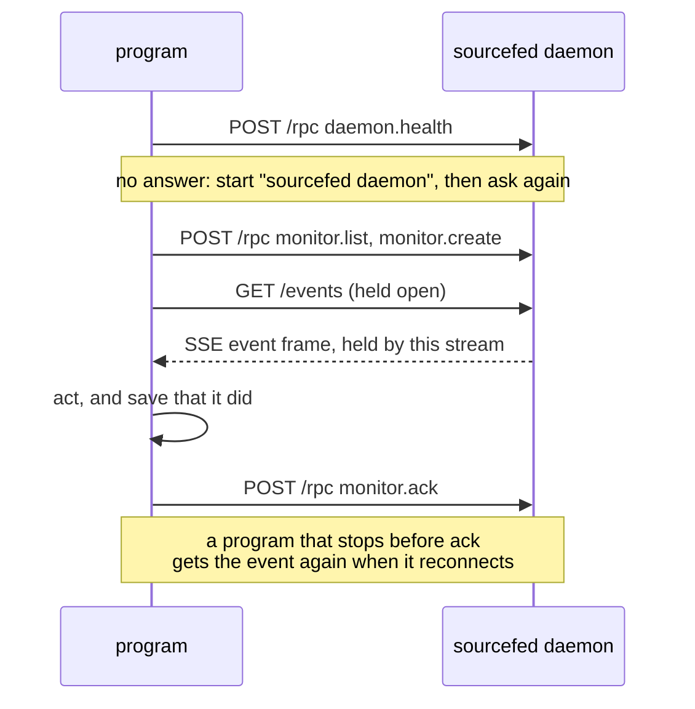

# Program targets

A program, not only an agent, can follow sources: every GitHub issue carrying a
label, every Jira issue matching a query, or a time of day. It owns a target of
kind `program`, reads that target's events itself, and acknowledges each one once
it has acted on it.

For example, atelier follows issues labelled `atelier:build` and a nightly
schedule, and starts a pipeline run for each event:

```sh
sourcefed monitor create --target-kind program --target-id atelier \
  --source-type github-issues --repo wrkhse/atelier --labels atelier:build \
  --include-existing --name atelier-build

sourcefed monitor create --target-kind program --target-id atelier \
  --source-type schedule --cron "0 2 * * *" --job nightly-audit --name nightly-audit
```



## Connecting over HTTP

A program speaks to the daemon over its HTTP API, as the OpenCode and Pi plugins
do. The daemon listens on `http://127.0.0.1:18787` (`SOURCEFED_DAEMON_PORT`
changes the port, `SOURCEFED_DAEMON_URL` the whole address). When it runs with
`SOURCEFED_DAEMON_TOKEN`, every `/rpc` and `/events` request sends
`Authorization: Bearer <token>`.

Each method is a `POST /rpc` with `{ "id": 1, "method": …, "params": … }`. It
answers `200` with `{ "id": 1, "result": … }`, `400` with
`{ "id": 1, "error": "…" }`, or `401` without the token.

1. **Check health.** `daemon.health` answers with sourcefed's version and the
   protocol, a small integer bumped by one on any breaking change to these
   methods or the event frames. Refuse a protocol you don't know.

   ```json
   { "id": 1, "method": "daemon.health" }
   { "id": 1, "result": { "ok": true, "version": "0.5.1", "protocol": 1 } }
   ```

2. **Start the daemon if none answers.** Run `sourcefed daemon --port 18787`
   detached, then ask `daemon.health` again every 150 ms for up to 10 s, as
   sourcefed's own clients do.

3. **List and create monitors.** `monitor.list` with `{ "target": … }` answers
   `{ "monitors": […] }`. `monitor.create` takes the target, a `name`, a
   `sourceType` and that source's fields, as `monitor create`'s flags. Creating
   the same source for the same target again answers the existing monitor with
   `created: false`; bad input answers `{ "ok": false, "error": … }`.

   ```json
   {
     "method": "monitor.create",
     "params": {
       "target": { "kind": "program", "id": "atelier" },
       "name": "atelier-build",
       "sourceType": "github-issues",
       "repo": "wrkhse/atelier",
       "labels": ["atelier:build"],
       "includeExisting": true
     }
   }
   ```

4. **Hold `GET /events` open.** `/events?target=<target>` takes the base64url of
   the JSON target: `{"kind":"program","id":"atelier"}` is
   `eyJraW5kIjoicHJvZ3JhbSIsImlkIjoiYXRlbGllciJ9`. The stream is server-sent
   events. It sends `{"type":"subscribed"}`, then what is already queued, then
   new events, each frame a batch; a `: keepalive` comment comes every 30 s.

   ```text
   data: {"type":"subscribed","target":{"kind":"program","id":"atelier"}}

   data: {"type":"event","target":{…},"events":[{"id":"m-…:item.matched:wrkhse/atelier#48:…","monitorID":"m-…","event":{"kind":"item.matched","subject":{…},…},"queuedAt":"…"}]}
   ```

5. **Acknowledge after acting.** `monitor.ack` with the queued events' `id`s
   removes them: `{ "target": …, "eventIDs": ["m-…"] }` answers
   `{ "ok": true, "acknowledged": ["m-…"] }`.

6. **Reconnect.** A stream holds the events it sent until they are
   acknowledged. When it closes, the next `/events` stream for the target gets
   every unacknowledged event again, in order.

## From a script

`monitor follow --json` holds the same stream for a script: it prints each
queued event as one line of JSON and never acknowledges.

```sh
sourcefed monitor follow --json --target-kind program --target-id atelier
sourcefed monitor ack --target-kind program --target-id atelier --event-id "m-…"
```

## The contract

- **At least once.** An event stays queued until the target acknowledges it. The
  stream that received it holds it; when that stream closes, a stream that
  reconnects receives it again. Acknowledge only after acting, and make acting
  twice harmless.
- **In order per monitor.** A monitor's events arrive in the order it found them.
  Events of different monitors interleave.
- **Bounded.** A target holds at most 1,000 unacknowledged events. A new event
  past that drops the oldest, and the target receives one `overflow` event for
  each monitor that lost events, outside the limit, counting what it lost. It
  stays one event, its count growing, until the target acknowledges it.
- **Rebuildable.** On `overflow`, or after time away, a program lists the source
  itself. A monitor created with `--include-existing` sends `item.matched` for
  every current item on its first poll, and `item.unmatched` reports what left,
  so a fresh monitor rebuilds the whole view.

## Events

| Kind | From | Subject |
| --- | --- | --- |
| `item.matched`, `item.unmatched` | `github-issues` | `{ type: "github-issue", key: "owner/repo#48", repo, number, url, title? }` |
| `item.matched`, `item.unmatched` | `jira-query` | `{ type: "jira-issue", key: "PROJ-7", url, title? }` |
| `schedule.fired` | `schedule` | `{ type: "schedule", key: job, job, at, cron, timezone }` |
| `schedule.missed` | `schedule` | the same, with `missed`, the count of times it stands for |
| `overflow` | any monitor | `{ type: "monitor", key: monitorID, dropped }` |
| `error` | `github-issues`, `jira-query` | none; more than 1,000 items match, and matching pauses |

Each event's `summary` and `body` are written for people and agents; a program
reads `kind` and `subject`. `item.unmatched` carries no title.

## Verification

- `packages/daemon/src/http-protocol.test.ts`: over plain HTTP, `daemon.health`,
  `monitor.create` and `monitor.list`; an event on `/events` comes again on a new
  stream until `monitor.ack`, and not after.
- `packages/daemon/src/client.test.ts`: the daemon the built CLI starts answers
  `daemon.health` with the root `package.json`'s version and protocol 1.
- `packages/cli/src/follow.test.ts`: `follow --json` prints events in order,
  acknowledges nothing, sends them again to a second `follow`, and `monitor ack`
  empties the queue.
- `packages/core/src/events.test.ts` and `storage/json.test.ts`: the oldest
  events go past the limit, one `overflow` per monitor counts them, and a new one
  starts after it is acknowledged.
