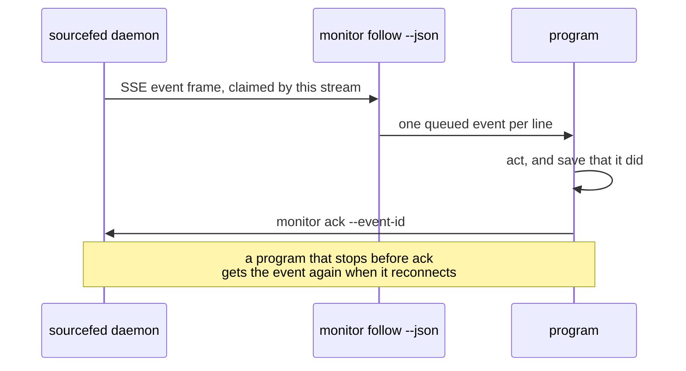

# Program targets

A program, not only an agent, can follow sources: every GitHub issue carrying a
label, every Jira issue matching a query, or a time of day. It owns a target of
kind `program`, reads that target's events itself, and acknowledges each one once
it has acted on it.

For example, atelier follows issues labelled `atelier:build` and a nightly
schedule, and starts a pipeline run for each event:

```sh
sourcefed monitor create --target-kind program --target-id atelier \
  --source-type github-issues --repo StevenJPx2/atelier --labels atelier:build \
  --include-existing --name atelier-build

sourcefed monitor create --target-kind program --target-id atelier \
  --source-type schedule --cron "0 2 * * *" --job nightly-audit --name nightly-audit
```



## Reading events

`monitor follow --json` prints each queued event as one line of JSON and never
acknowledges. It drains what is already queued, then prints new events as they
arrive.

```sh
sourcefed monitor follow --json --target-kind program --target-id atelier
```

```json
{"id":"m-…:item.matched:StevenJPx2/atelier#48:2026-11-13T10:00:00.000Z","monitorID":"m-…","target":{"kind":"program","id":"atelier"},"event":{"kind":"item.matched","subject":{"type":"github-issue","key":"StevenJPx2/atelier#48","repo":"StevenJPx2/atelier","number":48,"url":"…","title":"…"},"…":"…"},"queuedAt":"…"}
```

The program acknowledges by the queued event's `id`, repeating the flag for
several:

```sh
sourcefed monitor ack --target-kind program --target-id atelier \
  --event-id "m-…:item.matched:StevenJPx2/atelier#48:2026-11-13T10:00:00.000Z"
```

A program can also speak to the daemon directly: `GET /events?target=<target>`
over SSE, where `<target>` is the base64url of the JSON target
(`{"kind":"program","id":"atelier"}`), and `POST /rpc` with
`{ "method": "monitor.ack", "params": { "target": …, "eventIDs": […] } }`.

## The contract

- **At least once.** An event stays queued until the target acknowledges it. The
  stream that received it holds it; when that stream closes, a stream that
  reconnects receives it again. Acknowledge only after acting, and make acting
  twice harmless.
- **In order per monitor.** A monitor's events arrive in the order it found them.
  Events of different monitors interleave.
- **Bounded.** A target holds at most 1,000 unacknowledged events. A new event
  past that drops the oldest, and the target receives one `overflow` event for
  each monitor that lost events, outside the limit, counting what it lost. It
  stays one event, its count growing, until the target acknowledges it.
- **Rebuildable.** On `overflow`, or after time away, a program lists the source
  itself. A monitor created with `--include-existing` sends `item.matched` for
  every current item on its first poll, and `item.unmatched` reports what left,
  so a fresh monitor rebuilds the whole view.

## Events

| Kind | From | Subject |
| --- | --- | --- |
| `item.matched`, `item.unmatched` | `github-issues` | `{ type: "github-issue", key: "owner/repo#48", repo, number, url, title? }` |
| `item.matched`, `item.unmatched` | `jira-query` | `{ type: "jira-issue", key: "PROJ-7", url, title? }` |
| `schedule.fired` | `schedule` | `{ type: "schedule", key: job, job, at, cron, timezone }` |
| `schedule.missed` | `schedule` | the same, with `missed`, the count of times it stands for |
| `overflow` | any monitor | `{ type: "monitor", key: monitorID, dropped }` |
| `error` | `github-issues`, `jira-query` | none; more than 1,000 items match, and matching pauses |

Each event's `summary` and `body` are written for people and agents; a program
reads `kind` and `subject`. `item.unmatched` carries no title.

## Verification

- `packages/cli/src/follow.test.ts`: `follow --json` prints events in order,
  acknowledges nothing, sends them again to a second `follow`, and `monitor ack`
  empties the queue.
- `packages/core/src/events.test.ts` and `storage/json.test.ts`: the oldest
  events go past the limit, one `overflow` per monitor counts them, and a new one
  starts after it is acknowledged.
