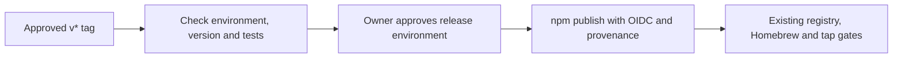

# Approve a release on GitHub

Status: Proposed. Configure both services with the owner's approval before merging
the workflow. No new version or tag is needed to set it up; do not rerun 0.5.1.

You can approve the `release` environment on GitHub instead of supplying an npm
one-time code for every version.

## One-time setup

These are separate live settings changes, not effects of opening the PR.

### GitHub

In StevenJPx2/sourcefed, open **Settings > Environments > New environment**:

- Name: `release`.
- Required reviewers: the user `StevenJPx2`, and no other reviewer.
- Leave **Prevent self-review** off: the owner also initiates the tags.
- Turn off **Allow administrators to bypass configured protection rules**.
- Deployment branches and tags: **Selected branches and tags**, with one tag rule
  named `v*` and no branch rules.

Read the settings back before merging. Merely naming an environment in a workflow
does not protect it: GitHub can create missing environments without reviewers.
`scripts/release/environment.mjs` therefore reads the existing environment and
its deployment policies before the publish job can start. Missing environments,
missing or different reviewers, or broader tag/branch policies fail the workflow.
The script only reads settings; the administrator-bypass setting also needs
checking in GitHub's UI.

### npm

For `@fdcn/sourcefed`, open **Settings > Trusted publishing** and add or update
the GitHub Actions publisher:

| Field | Value |
| --- | --- |
| Organization or user | `StevenJPx2` |
| Repository | `sourcefed` |
| Workflow filename | `release.yml` |
| Environment name | `release` |
| Allowed actions | Direct `npm publish` enabled |

Keep dist-tag management disabled; this workflow does not need it. Confirm that
the package's publishing-access policy permits this trusted publisher to publish
directly, rather than requiring staged publishing.

The workflow uses a GitHub-hosted Ubuntu runner, Node 24 and npm 11 (at least
11.15). Only the environment-protected publish job has `id-token: write`.
It passes no npm token and has no token fallback. The repository's `NPM_TOKEN`
secret and `~/.config/npm/fdcn-publish.npmrc` remain untouched; they are not used
by this workflow.

## Each release

1. Verify the candidate and review its captures using the existing release
   process. Ask before pushing a new version's tag.
2. Push the approved tag. The `verify` job checks the environment configuration,
   matches the tag to the public manifest version, installs dependencies and runs
   `npm run check`. A test failure fails the job; it is not retried.
3. Review the tag, commit and successful checks in the GitHub run. Approve the
   `release` deployment under **Review deployments** (or reject it to stop).
4. The protected publish job builds and checks that same tag again, then runs
   `npm publish --access public --provenance` from `packages/sourcefed`.
   npm verifies the short-lived OIDC identity for this workflow and environment.
5. Confirm the published integrity, then run the existing registry, Homebrew and
   tap checks. GitHub approval does not replace artifact review or authorize tap
   and installation changes.

There is no `npm stage approve` in this flow. Missing OIDC configuration or npm
permission fails the publish; it must not fall back to an interactive login,
a token or a different workflow. A failed run is not evidence of publication:
check npm before considering a retry. Never rerun a completed version.

## Verification

- `node --test scripts/release/tooling.test.mjs` checks the fail-closed
  environment policy with absent reviewers, a different owner, unrestricted
  deployments, a branch rule, a wildcard tag and additional policies.
- `actionlint .github/workflows/release.yml` checks workflow syntax.
- Before setup, the read-only check against the real repository must fail because
  the `release` environment is absent. After setup, run it again:
  `GITHUB_REPOSITORY=StevenJPx2/sourcefed node scripts/release/environment.mjs`
  using authenticated `gh`.
- Live OIDC publication and the deployment approval wait are unverified until the
  next owner-approved new release. No test tag or package is published for this PR.

References: [npm trusted publishers](https://docs.npmjs.com/trusted-publishers/),
[GitHub environments](https://docs.github.com/en/actions/how-tos/deploy/configure-and-manage-deployments/manage-environments).
