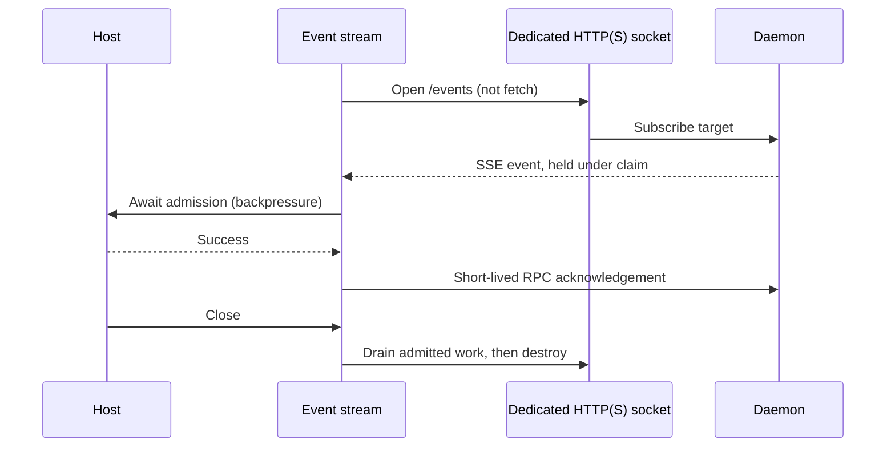

# Daemon application and transports

The daemon owns monitor commands, queue claims and acknowledgement. Adapters own
host identities and callbacks; transport code does not decide delivery policy.

| Module | Responsibility |
| --- | --- |
| `daemon.ts` | `SourcefedDaemon`: application operations, subscriptions and event claims. |
| `dispatch.ts` | Dispatch JSON RPC method names to application operations. |
| `http.ts` | Authenticate RPC/SSE requests and expose daemon events over HTTP. |
| `client.ts` | `connectDaemonClient`: short-lived RPC, owned subscriptions, acknowledgement retry and client shutdown. |
| `event-stream.ts` | `DaemonEventStream`: setup, SSE frame parsing, serialized delivery/ack, reconnect and bounded draining. |
| `event-transport.ts` | `openEventResponse` / `eventReader`: dedicated HTTP(S) sockets, status checks and a byte-bounded reader outside Bun’s fetch queue. |
| `registry.ts` | Compose built-in source providers. |
| `types/` | Existing public daemon/client contracts and JSON protocol frames. |
| `utils/` | Environment, daemon spawn/discovery, target encoding, event sink and Node HTTP server adapters. |
| `index.ts` | Package entrypoint. |

Client lifecycle:

```ts
const client = await connectDaemonClient({ name: "host", url: daemonURL })
try {
  const listener = await client.subscribe(target, async (events) => {
    await admitToHost(events) // success is acknowledged by the client
  }, { signal: lifetime.signal })
  await listener.close() // drains admitted callback/ack before closing the socket
} finally {
  await client.close() // also cancels pending setup
}
```



- Callback failure closes the connection and allows replay; acknowledgement failure
  retries without repeating a successful callback.
- Setup and drain have 15-second bounds. Reconnect waits are cancellable.
- `client.test.ts` and `stream-lifecycle.test.ts` prove delivery and cleanup over HTTP.
- `fetch-isolation.test.ts` proves 300 streams do not starve Bun fetch or ack.
- `event-transport.test.ts` proves untrusted HTTPS is rejected. The isolated host
  probe in `scripts/check-opencode-subscriptions.mjs` proves trusted HTTPS too.

See [subscription lifecycle](../../../docs/subscription-lifecycle.md) for OpenCode
ownership, transport limits, verification commands and rollout.
