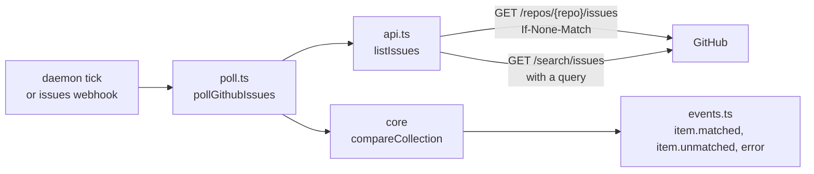

# GitHub issue collections

The `github-issues` source follows every open issue in a repository that carries
all of its labels, optionally narrowed by assignee, author or search terms. It
tells a program when an issue starts matching and when it stops.

```sh
sourcefed monitor create --target-kind program --target-id atelier \
  --source-type github-issues --repo StevenJPx2/atelier --labels atelier:build \
  --include-existing --name atelier-build
```



| Module | Responsibility |
| --- | --- |
| `monitor.ts` | `GithubIssuesMonitor`: builds and checks the source, its input schema, and the webhook wake. |
| `poll.ts` | `pollGithubIssues`: one poll, from the listing to the events and the next cursor. |
| `api.ts` | `listIssues`: every matching issue, through the issues list or the search API. |
| `events.ts` | The events and their `github-issue` subject. |
| `schema.ts` | The source record and the cursor. |
| `fixtures/` | Replies shaped on recorded GitHub replies, for `issues.test.ts`. |

- **The cursor is the set of matching keys** (`owner/repo#48`), compared by core's
  `compareCollection`. A new key is `item.matched`, a gone one `item.unmatched`;
  closing an issue removes it from the open list. The first poll primes silently
  unless `includeExisting`.
- **ETag.** A list that fits one page keeps its ETag, and the next poll sends it;
  a `304` sends nothing and keeps the cursor. A list over several pages is read
  in full each time, following the `Link` header.
- **Bounded.** At most 20 pages of 100 are read. Past 1,000 matching issues the
  monitor sends one `error` event and keeps its keys, so nothing is reported
  unmatched, until fewer match.
- **Never a partial list.** A failed reply or incomplete search results throw, so
  the poll keeps its cursor and tries again on the next interval.
- **Webhook wake.** With `SOURCEFED_GITHUB_WEBHOOK_SECRET` set, a verified
  `issues` webhook for the repository makes the monitor's next tick poll at once.
