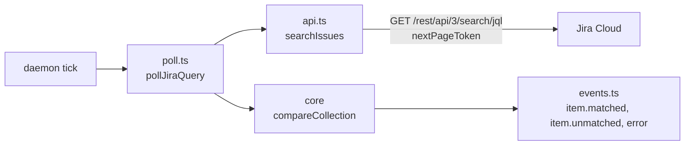

# Jira query collections

The `jira-query` source follows every Jira issue matching a JQL query. It tells a
program when an issue starts matching and when it stops.

```sh
sourcefed monitor create --target-kind program --target-id atelier \
  --source-type jira-query --jql "project = PROJ AND labels = agent" \
  --include-existing --name agent
```



| Module | Responsibility |
| --- | --- |
| `monitor.ts` | `JiraQueryMonitor`: builds and checks the source, and its input schema. |
| `poll.ts` | `pollJiraQuery`: one poll, from the search to the events and the next cursor. |
| `api.ts` | `searchIssues`: every matching issue through Jira's enhanced search. |
| `events.ts` | The events and their `jira-issue` subject. |
| `schema.ts` | The source record. |
| `fixtures/` | Replies shaped on recorded Jira replies, for `query.test.ts`. |

- **The cursor is the set of matching keys** (`PROJ-7`), compared by core's
  `compareCollection`, as for `github-issues`. The first poll primes silently
  unless `includeExisting`.
- **Ordered by key.** `ORDER BY key ASC` is added unless the JQL orders itself,
  so pages follow one another steadily.
- **Bounded.** Pages of 100, chained by `nextPageToken`, at most 11. Past 1,000
  matching issues the monitor sends one `error` event and keeps its keys.
- **Never a partial list.** A failed reply throws with Jira's message, such as an
  unbounded query's, and the poll keeps its cursor.
- **No ETag.** Jira's search gives none, so each poll reads the whole list.
- **A field Jira doesn't know matches nothing**: Jira answers such a query with an
  empty list, which reports every issue unmatched. Check the JQL in Jira first.
