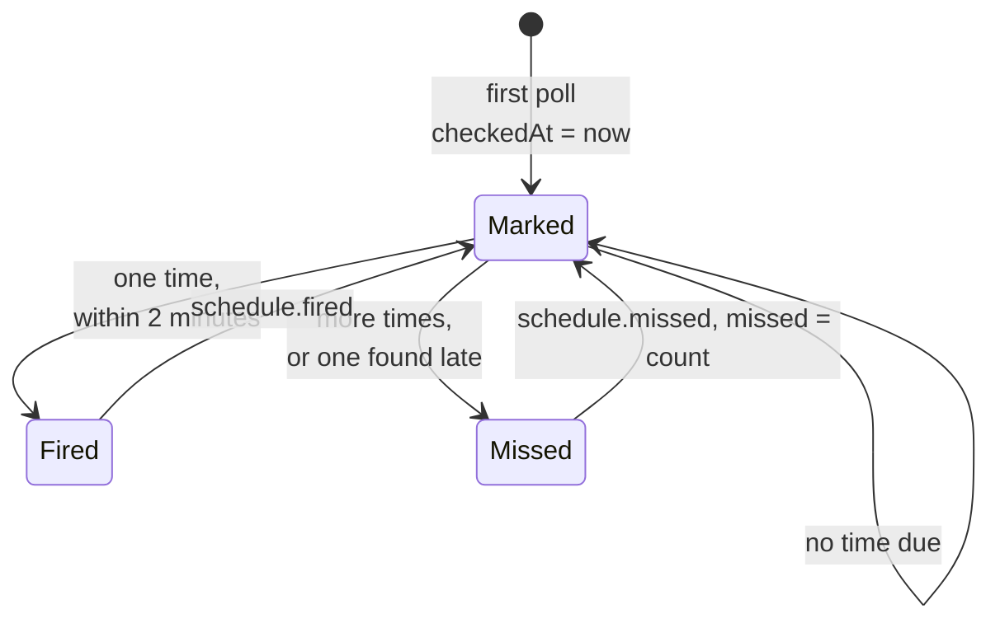

# Schedules

The `schedule` source sends an event at each time of a cron expression, in an
IANA time zone. It tells a program when to run something; whether the work runs
is the program's choice.

```sh
sourcefed monitor create --target-kind program --target-id atelier \
  --source-type schedule --cron "0 2 * * *" --timezone Asia/Kolkata \
  --job nightly-audit --name nightly-audit
```



| Module | Responsibility |
| --- | --- |
| `monitor.ts` | `ScheduleMonitor`: builds and checks the source, its input schema, and its 15-second default. |
| `poll.ts` | `pollSchedule`: the times since the last check become one event, or none. |
| `firings.ts` | croner: the times in a window, the system zone, and ISO times with the zone's offset. |
| `events.ts` | `schedule.fired` and `schedule.missed`, with their `schedule` subject. |
| `schema.ts` | The source record and the cursor. |

```json
{
  "kind": "schedule.missed",
  "at": "2026-11-16T02:00:00+05:30",
  "subject": {
    "type": "schedule",
    "key": "nightly-audit",
    "job": "nightly-audit",
    "at": "2026-11-16T02:00:00+05:30",
    "cron": "0 2 * * *",
    "timezone": "Asia/Kolkata",
    "missed": 3
  }
}
```

- **The cursor is one instant**, `checkedAt`. Each poll looks at the times in
  `(checkedAt, now]` and moves the mark to now. The first poll only sets it.
- **Fired or missed.** One time found within two minutes of it is
  `schedule.fired`. Anything else, such as times that came while the daemon was
  stopped or the Mac slept, is one `schedule.missed` with the latest time as `at`
  and the count as `missed`.
- **Every 15 seconds** by default (`defaultPollIntervalSec`), so a firing arrives
  within about 15 seconds. A poll interval past two minutes turns firings into
  `schedule.missed`.
- **Bounded.** Counting stops at 1,000 times; past it, `missed` is 1,000 and `at`
  is still the latest time.
- **Daylight saving** follows croner: in spring a time the clock skips fires once
  at the new hour; in autumn a time the clock repeats fires once.
- **Checked when created.** An invalid cron or unknown time zone is refused by
  `build`.
