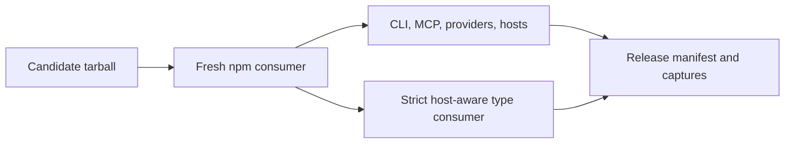

# Installed-artifact release gates

Status: In progress. Human visual review and post-publication checks remain
required. The release contract is [the E2E plan](../../docs/e2e-release-plan.md).



Run the full pipeline from the repository root:

```sh
npm run release:verify -- --dry-run
```

| Module | Responsibility |
| --- | --- |
| `harness.mjs` | Allowlisted environments, bounded process groups, hashes, evidence |
| `package.mjs` | Install the exact archive; validate exports and Pi-free runtime |
| `scenarios.mjs` | Registry compiler/client tools and installed integration tests |
| `types.mjs` | Strict library consumer; host consumer with pinned upstream diagnostics |
| `cli-daemon.mjs` | Installed CLI and daemon lifecycle |
| `mcp.mjs`, `mcp-stdio.worker.mjs` | Real MCP HTTP and stdio boundaries |
| `providers.mjs`, `webhooks.mjs` | Local HTTP polling and signed webhook delivery |
| `opencode.mjs` | Actual OpenCode plugin/tool and transport checks |
| `terminal.mjs` | Terminal Control visible-state capture and owned-session cleanup |
| `pi.mjs` | Pi managed installation, RPC loading and production audit |
| `registry-canary.mjs` | Published integrity, fresh consumers and host evidence |

`context` carries the exact artifact path, SHA-256, npm integrity, source commit,
version, owned workspace and consumer paths. Gates return evidence details or
throw a failure; `Blocked` represents a missing prerequisite. The orchestrator
records every result and rejects skipped or failed prepublication gates.

The ordinary consumer contains no Pi host packages. Only the host type consumer
supplies Pi and OpenCode TUI peers; it keeps library checking enabled and accepts
only the upstream diagnostics listed in `upstreamDiagnostics`.

Regression checks live in `scripts/release/tooling.test.mjs`. Full validation
uses the real installed package, private HTTP fixtures and actual host binaries.
