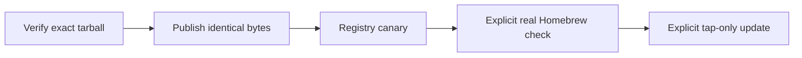

# Release commands

Status: In progress. Publication and real Homebrew validation require operator
authorization. See the [release contract](../../docs/e2e-release-plan.md).



| Module | Responsibility |
| --- | --- |
| `verify.mjs` | Pack once, isolate gates, retain manifest and logs |
| `artifact.mjs` | Reject missing gates, changed source and changed artifact bytes |
| `publish.mjs` | Opt-in authenticated push/publication after verification |
| `registry.mjs` | Resume the postpublication registry canary; adopt a CI-repacked tarball with the same tar |
| `homebrew.mjs` | Explicit-consent upgrade, test and keep, or exact rollback |
| `pins.mjs` | Independent tap, dotfiles and Pi selectors |
| `tooling.test.mjs` | Fail-closed, isolation, tampering and selector tests |

Start with a mutation-free candidate check:

```sh
npm run release:verify -- --dry-run
```

After authorized publication and registry verification:

```sh
npm run release:homebrew -- --confirm-real-homebrew

npm run release:pins -- --tap
```

`assertPublishable(record, state, version)` binds required passing gates to a
clean source snapshot and the candidate SHA-256. `assertPinsAllowed` requires
registry proof and artifact-bound Homebrew proof for tap updates. Homebrew
upgrades the installed Sourcefed from the candidate formula in the local tap
checkout, restores that file, and keeps the new keg only after `brew test` and
`skills list` pass. Failure relinks the previous keg; other formulae never change.

Run safety tests independently with:

```sh
node --test scripts/release/tooling.test.mjs
```
